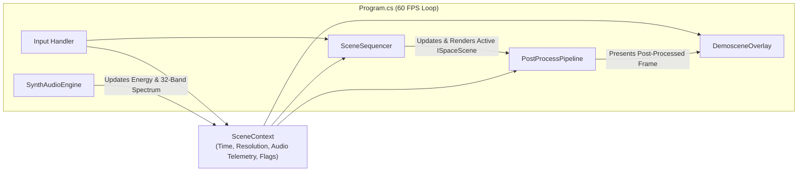

# Starship Odyssey — GPU Space Travel Demoscene

**Starship Odyssey** (`SpaceTravel`) is a real-time, self-contained 2D/3D procedural space demoscene built with **.NET 9**, **Raylib-cs**, and custom **OpenGL 3.3 (GLSL 330)** fragment shaders. Inspired by classic Amiga and PC demoscene productions, every visual and audio element—from volumetric nebulae and boiling solar coronas to the 120 BPM stereo synthwave soundtrack—is generated procedurally in memory with zero external asset files.

---

## General Information

### Key Features
- **Zero External Assets**: All textures, shaders, particle systems, and audio waves are synthesized at runtime.
- **4 Distinct Space Scenes**: Automatic or manual sequencing across four cosmic environments with smooth hyperspace warp/flash transitions.
- **Procedural Space-Synth Audio**: Real-time synthesized 16-second stereo loop (120 BPM) driving beat-reactive visuals (`BassEnergy`, `MidEnergy`, `HighEnergy`, `BeatPulse`, and a 32-band spectrum).
- **Post-Processing Pipeline**: Offscreen render-target pipeline featuring multi-tap bright-pass HDR bloom, beat-reactive radial chromatic aberration, hyperspace transition distortion, cinematic vignetting, and an optional retro CRT curvature/scanline/phosphor-grille filter.
- **Classic Demoscene HUD**: Top telemetry header with scene progress, status badges, and a 32-band real-time spectrum analyzer, paired with a bottom Amiga-style copper bar and per-character sine-wave scroller.

### Featured Scenes
1. **3D Hyperspace Warp Field** (`WarpStarfieldScene`)
   - **Visuals**: 4,500 volumetric 3D stars with camera roll/banking, velocity-stretched relativistic streaks, and beat-reactive warp surges over a procedural FBM nebula warp tunnel shader.
   - **Default Duration**: 13.0s
2. **Horizontal Sector Cruise** (`HorizontalParallaxScene`)
   - **Visuals**: 6-layer horizontal parallax starfield (1,600 stars with motion streaks and twinkling), scrolling multi-octave FBM emission nebula with cosmic dust lanes, Amiga-inspired horizon glow, and a vector interceptor starship with an ion ribbon trail and forward sensor sweep.
   - **Default Duration**: 13.0s
3. **Hypergiant Solar Corona Patrol** (`GiantStarCoronaScene`)
   - **Visuals**: Fullscreen GPU-raymarched boiling hypergiant photosphere using domain-warped 3D Fractional Brownian Motion (FBM), limb darkening, erupting magnetic loop prominences, anamorphic solar lens flare, and 220 foreground coronal mass ejection (CME) plasma sparks.
   - **Default Duration**: 14.0s
4. **Dynamic Spiral Galaxy** (`DynamicGalaxyScene`)
   - **Visuals**: 5,500 3D particles arranged across 4 spiral arms, a central galactic bulge, and a spherical halo undergoing differential Keplerian rotation, mixed with glowing H-II star-forming nebula knots, a volumetric core glow, and a sweeping 3D orbital camera.
   - **Default Duration**: 14.0s

### Controls

| Key | Action |
| :--- | :--- |
| `Right` / `Down` | Transition to next scene |
| `Left` / `Up` | Transition to previous scene |
| `1` – `4` | Jump directly to Scene 1–4 |
| `Space` | Toggle automatic scene sequencing (`AUTO-SEQ` / `LOCKED`) |
| `B` | Toggle HDR Bloom post-processing (`BLOOM:ON` / `BLOOM:OFF`) |
| `C` | Toggle Retro CRT curvature & scanlines (`CRT:ON` / `CRT:OFF`) |
| `H` | Show / hide the Demoscene HUD & scroller |
| `M` | Mute / unmute the procedural space-synth soundtrack |
| `F11` / `Alt + Enter` | Toggle fullscreen mode |
| `Esc` | Exit application |

---

## Technical Information

### Tech Stack & Prerequisites
- **Runtime & SDK**: .NET 9.0 (`net9.0`, Windows executable output `WinExe`, `AllowUnsafeBlocks` enabled)
- **Graphics & Audio Binding**: [Raylib-cs](https://github.com/ChrisDill/Raylib-cs) `6.1.1` (OpenGL 3.3 / GLSL `#version 330`)
- **Window Configuration**: Default `1600x900` @ 60 FPS, resizable window, 4x MSAA hint, VSync enabled.

### Building and Running

```powershell
# Restore dependencies and build in Release mode
dotnet build -c Release

# Run the application
dotnet run -c Release
```

### Architecture Overview



#### 1. Core Framework (`Core/`)
- **`ISpaceScene`**: Common lifecycle interface (`Load`, `OnEnter`, `Update`, `Render`, `Dispose`) implemented by all cosmic scenes.
- **`SceneContext`**: Shared state container passed each frame to all subsystems. Tracks viewport dimensions, `TotalTime`, `SceneTime`, `DeltaTime`, audio-reactive telemetry (`BassEnergy`, `MidEnergy`, `HighEnergy`, `BeatPulse`, and `float[32] Spectrum`), and visual toggle states (`CrtEnabled`, `BloomEnabled`, `HudEnabled`, `AudioMuted`).
- **`SceneSequencer`**: Manages scene registration, auto-advance timers, and smooth `1.1s` transitions. Uses a sine envelope ($\sin(\pi \cdot t)$) peaking at $t = 0.5$, switching the underlying scene at peak hyperspace flash while feeding `TransitionProgress` into the post-processing shader.
- **`ShaderHelper`**: Utility wrapper for compiling in-memory GLSL 330 fragment shaders (`Raylib.LoadShaderFromMemory`), setting typed shader uniforms (`float`, `int`, `vec2`, `vec3`, `vec4`), and rendering fullscreen normalized UV quads.

#### 2. Rendering & Post-Processing (`Rendering/`)
- **`PostProcessPipeline`**:
  - Captures scene rendering into an offscreen `RenderTexture2D` that automatically resizes with the window.
  - Applies a single-pass composite GLSL fragment shader featuring:
    - **CRT Barrel Distortion**: Optional screen curvature (`crtCurve`), horizontal scanline modulation, and RGB phosphor grille mask.
    - **Radial Warp & Chromatic Aberration**: Dynamically separates R/G/B channels radially based on `uBeatPulse` and `uTransition`.
    - **5x5 Bright-Pass Bloom**: Distance-weighted 25-tap kernel extracting luminance above `0.35` and additively boosting bright emitters in sync with the beat.
    - **Hyperspace Transition Flash & Vignette**: Smoothly blends into a cyan-white flash at transition peaks and applies a radial smoothstep vignette.
- **`DemosceneOverlay`**: Renders the 2D HUD on top of the post-processed frame so text remains crisp, including a HSV-colored 32-band spectrum analyzer and a per-character sine-wave scroller.

#### 3. Procedural Audio Synthesis (`Audio/SynthAudioEngine.cs`)
- Synthesizes a 16-second, 44.1 kHz, 16-bit stereo PCM `.wav` file directly in a `MemoryStream` at startup (32 beats / 8 bars at 120 BPM) and loads it into Raylib's audio device.
- **Harmonic Structure**: 4-bar cosmic progression ($\text{Cm} \rightarrow \text{A}\flat \rightarrow \text{E}\flat \rightarrow \text{B}\flat$) combining:
  1. Exponentially pitch-swept synth kick + saturated 16th-note sawtooth sub-bass.
  2. Pulse-width modulated (PWM) stereo-panned chiptune/synthwave arpeggiator.
  3. Detuned 3-voice stereo cosmic pad (root, minor third, fifth).
  4. LCG white-noise hi-hat and space shimmer on 16th steps with loop boundary crossfading.
- **Real-Time Envelope Follower**: Computes deterministic phase-locked envelopes (`BeatPulse`, `BassEnergy`, `MidEnergy`, `HighEnergy`) and smooths a 32-band frequency spectrum each frame to drive shader uniforms and particle velocities even if audio hardware is unavailable or muted.

### Project Structure

```text
SpaceTravel/
├── Program.cs                        # Entry point, window lifecycle, main render loop, keyboard input
├── SpaceTravel.csproj                # .NET 9 project configuration and Raylib-cs dependency
├── Audio/
│   └── SynthAudioEngine.cs           # In-memory WAV synthesizer & real-time audio telemetry
├── Core/
│   ├── ISpaceScene.cs                # Scene contract interface
│   ├── SceneContext.cs               # Per-frame shared state, audio metrics, and visual flags
│   ├── SceneSequencer.cs             # Scene state machine and transition envelope controller
│   └── ShaderHelper.cs               # GLSL 330 shader compilation and uniform helpers
├── Rendering/
│   ├── DemosceneOverlay.cs           # Telemetry bar, 32-band visualizer, and sine-wave scroller
│   └── PostProcessPipeline.cs        # Offscreen render target, HDR bloom, chromatic aberration, CRT shader
└── Scenes/
    ├── WarpStarfieldScene.cs         # Scene 1: 3D relativistic starfield + FBM warp tunnel shader
    ├── HorizontalParallaxScene.cs    # Scene 2: 6-layer parallax stars + emission nebula + patrol ship
    ├── GiantStarCoronaScene.cs       # Scene 3: Raymarched 3D FBM hypergiant star + corona flames + CME sparks
    └── DynamicGalaxyScene.cs         # Scene 4: 5,500-particle Keplerian 3D spiral galaxy + H-II knots
```

## License

The source code is released under the [MIT License](LICENSE). Copyright (c) 2026 BlackLizard (bytejuggler.com). Raylib-cs and raylib, restored from NuGet, keep their own (zlib) licenses.
